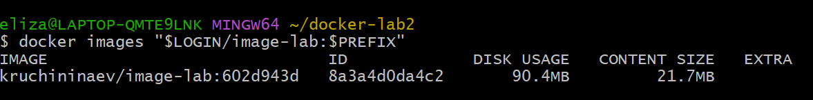
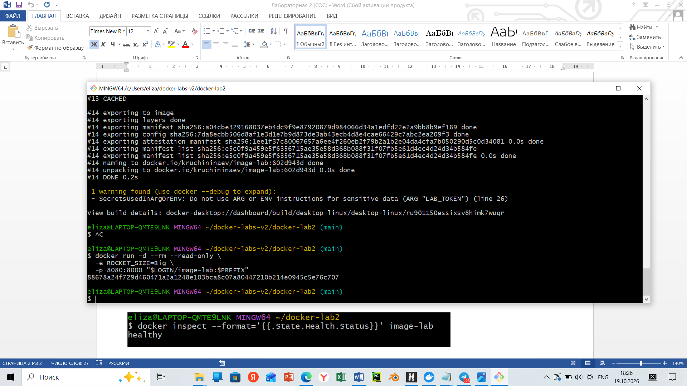
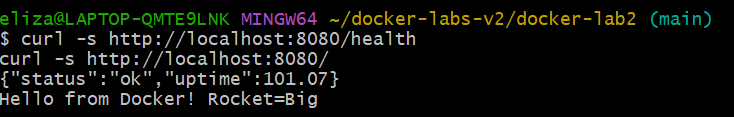
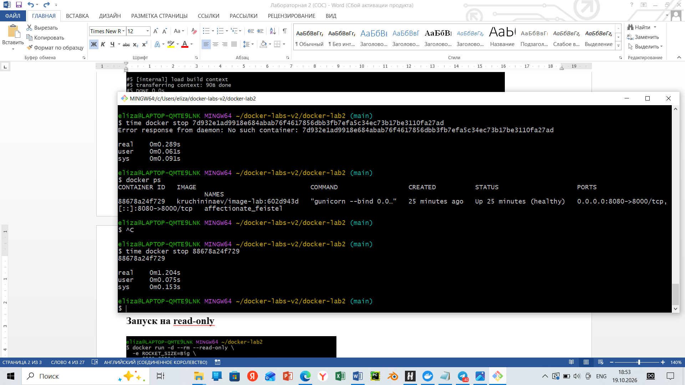
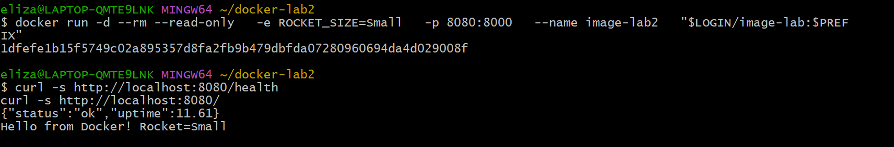

# Ответы на задание

## 1. В Dockerfile LAB_LOGIN и LAB_TOKEN используются только как аргументы сборки и метки образа.

При этом в приложении они считываются из переменных окружения. Объясните, какие значения получит приложение при обычном запуске и как это связано с работой `/proof`.

**Ответ:**
В Dockerfile LAB_LOGIN и LAB_TOKEN используются только как аргументы сборки: они существуют только на этапе `docker build` и используются исключительно для заполнения меток образа. 

Приложение читает данные из переменных окружения контейнера. При обычном запуске (`docker run` без `-e`) этих переменных в окружении нет, поэтому приложение получает `None` (или пустые значения).

`/proof` нужен, чтобы показать полученные логин и токен. Т.к. при обычном запуске данные отсутствуют, то `/proof` вернёт пустой результат.

## 2. Уменьшение размера образа достигается за счёт того, что

- **Использован Alpine Linux вместо полноценного OS.** В качестве базового образа выбран `python:3.12-alpine`, который значительно компактнее стандартного `python:3.12`.
- **Установка зависимостей с флагом `--no-cache-dir`.** Флаг `pip install --no-cache-dir` отключает создание кэша пакетов, поэтому в образ не попадают временные файлы pip.
- **Копирование только нужного.** В финальный образ копируется только код приложения (`COPY app/ ./app/`) и установленные пакеты, без лишних директорий и файлов.

**Проверка размера:**

*Size < 150 MB*

## 3. В .dockerignore не исключены seed-файлы, хотя они исключены из Git.

Добавила `seed-*.json` в `.dockerignore`.

## 4. Работа контейнера в режиме --read-only:

**Проверка ответа:**

**Назначение --worker-tmp-dir /dev/shm:**
`--worker-tmp-dir /dev/shm` указывает Gunicorn хранить временные файлы не в стандартной директории `/tmp`, а в `/dev/shm`. 
`/dev/shm` - это `tmpfs` (файловая система в оперативной памяти), следовательно, операции в ней происходят значительно быстрее.

**Корректное завершение контейнера по SIGTERM:**

**Изменение ROCKET_SIZE без пересборки:**
Останавливаем и запускаем тот же образ, `ROCKET_SIZE=Small`.

Видно, что ответ зменился, при этом образ не пересобирался.
