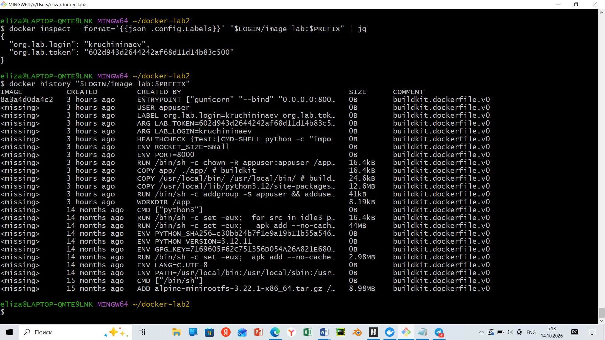

# Лабораторная: Продакшн-образы Docker

## Ссылка на образ
https://hub.docker.com/r/kruchininaev/image-lab/tags

## Вывод docker history <login>/image-lab:<prefix>

## Мой production-образ лучше "наивной" сборки потому что:
1) Размер < 150MB - использован Alpine Linux.
Многостадийная сборка эффективно уменьшает размер образа за счет исключения компиляторов

2) Контейнер запускается под пользователем без root прав, что повышает уровень безопасности

3) Запуск в режиме Read-Only, что так же увеличивает безопасность

4) Использование переменных окружения, что является возможностью изменять поведение приложения без пересборки (ROCKET_SIZE)

5) HEALTHCHECK- Docker автоматически мониторит работоспособность приложения

6) Корректно завершается по SIGTERM

7) Умное кэширование: зависимости грузятся один раз, а код можно менять много раз без переустановки.
