# ЛР: Redis + Rocket Counter. От `docker run` к `docker compose` и масштабированию

### Часть 1. Запуск вручную (контейнеры `docker run`)

1. **Создание Redis** (имя контейнера `redis`, образ `redis`).
Выполнена **проверка:** `docker ps` показывает, что контейнер `redis` в состоянии `Up`:

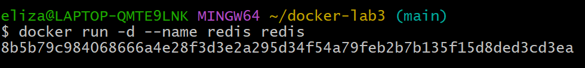
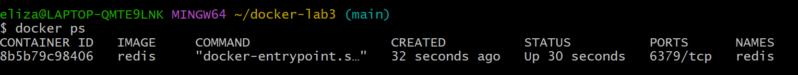
 

2. **Создайте приложение rocketcounter** из образа `rotorocloud/rocket-counter`, свяжите с Redis при помощи `--link` и опубликуйте на **8085** хоста (в контейнере порт **5000**):

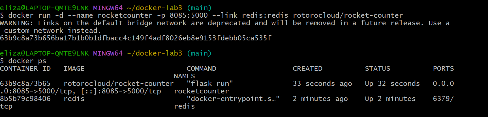
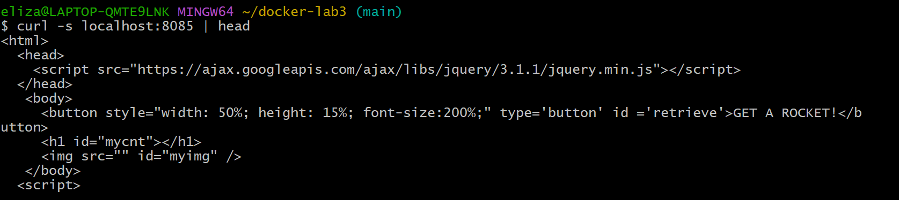

> Примечание: появилось прдупреждение о том, что механизм связи через `--link` считается устаревшим и в будущих версиях Docker может быть удалён, о чём было сказано в тексте к лабораторной 

Выполнена **проверка:**

   * `docker ps` — контейнер `rocketcounter` слушает `0.0.0.0:8085->5000/tcp`
   * `curl -s localhost:8085 | head` — возвращается HTML страницы счетчика

Проверяем, что **число растёт**:

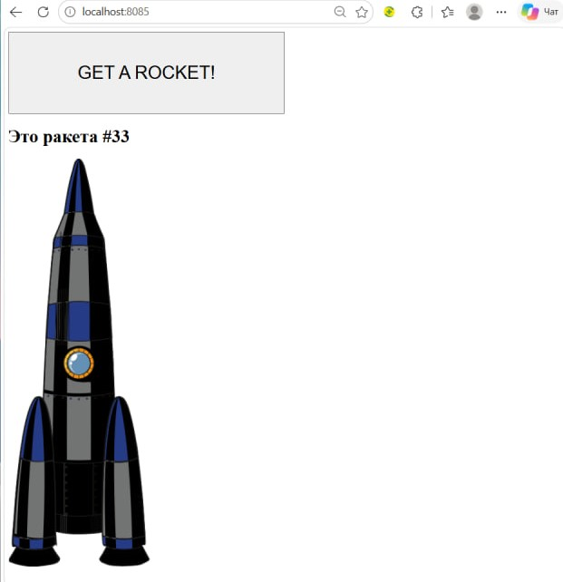
 
3. **Удаляем контейнеры redis и rocketcounter**:

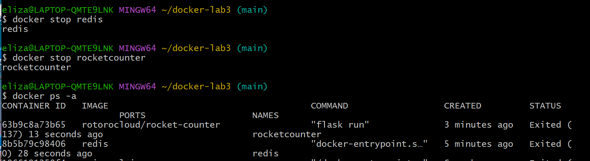
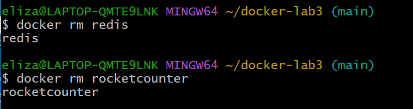

---

### Часть 2. Описание стека в `docker-compose.yml`

1. Создадим каталог `/root/rocketcounter` и перейдём в него:

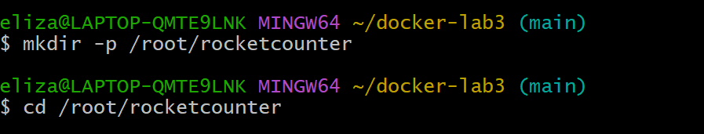

2. Создаём файл **`docker-compose.yml`** со следующими требованиями:

   * Сервис **`redis`**: `image: redis`.
   * Сервис **`rocketcounter`**: `image: rotorocloud/rocket-counter`.
   * Приложение работает на порту **5000** в контейнере, опубликовать на **8085** хоста.
   * Связь `rocketcounter` ↔ `redis` должна обеспечиваться средствами Compose (общая сеть по умолчанию). `links` в Compose **не требуются**.

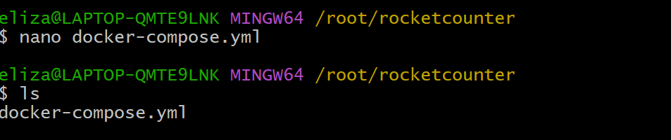
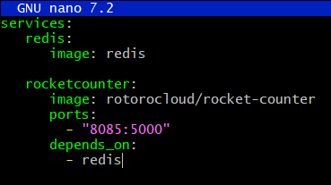 
 
3. **Запускаем стек**:

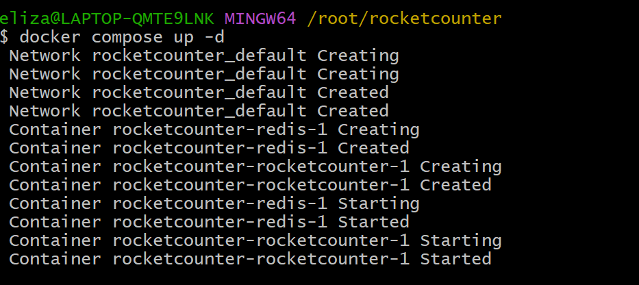
 

**Проверка:**

   * `docker compose ps` — оба сервиса `Up`.
   * `curl -s localhost:8085 | head` — страница открывается, счетчик работает.

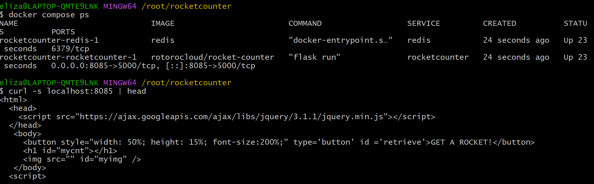
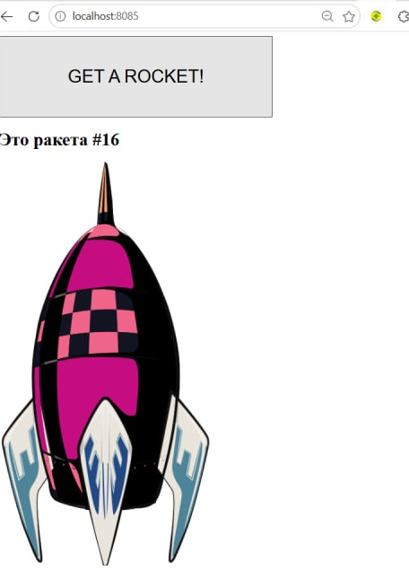
---
 
### Часть 3. Масштабирование приложения
Изменяем публикацию портов на динамическую (эпемерные порты для каждого экземпляра):
 
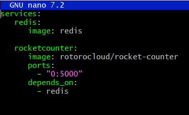

Применяем изменения, масштабируем и выполняем проверку:

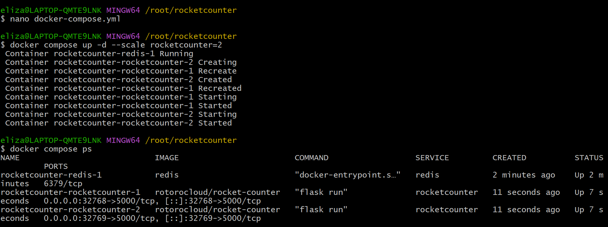
 
В выводе у обоих экземпляров `rocketcounter` **разные** хост-порты **32768** и **32769**.

Открываем оба URL (http://localhost:32768 и http://localhost:32769), счётчик **общий** (хранится в одном Redis):

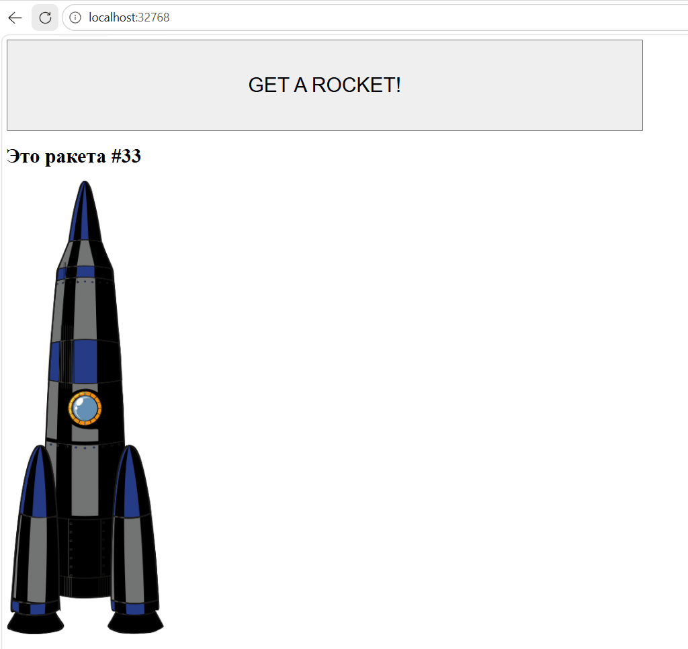
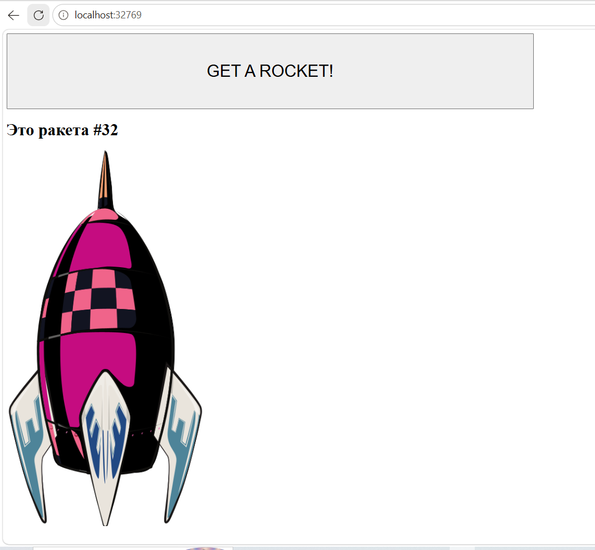

---

### Часть 4. Полное уничтожение стека

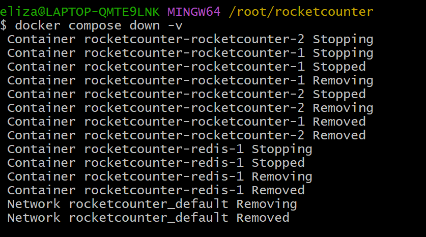
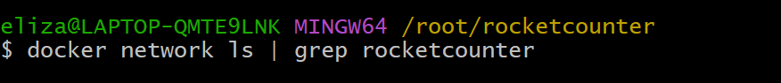
 
---

## 6. Вопросы
1. Зачем в Ч.1 использовался `--link` и почему в Compose он не нужен?
--link используется для записи в /etc/hosts контейнера rocketcounter ip-адреса контейнера redis, это нужно для того, чтобы контейнеры могли находить друг друга. 
Compose же автоматически создает для контейнеров общую сеть, в которой они могут видеть друг друга.

2. Чем отличается `image` от `build` в Compose?
image указывает на готовый уже образ, например, с Dockerhub'a build указывает путь к Dockerfile, из которого уже собирается образ.

3. Почему нельзя масштабировать сервис с публикацией фиксированного порта на одном хосте? Перечислите способы обойти это ограничение
Несколько контейнеров не могут слушать один и тот же сетевой порт одновременно. Как это обойти:
*Через динамические порты, как сделано в лабораторной (контейнеры публикуются на разных портах)
*Через Reverse Proxy на основе nginx (когда с определенного порта идет перенаправление на множество неопубликованных контейнеров)
*Через встроенный оркестратор Docker Swarm (тоже, что и reverse proxy, но может автоматически расширяться и поддерживает несколько серверов)

4. Что делает `docker compose down -v` и чем отличается от `down` без `-v`?
docker compose down удаляет контейнеры и сети. docker compose down -v также удаляет и созданные тома. Если же их не удалять, то данные там будут сохраняться между перезапусками.

5. Как в Compose обеспечивается сетевое имя сервиса для обращения из другого сервиса?
В Compose автоматически создается общая сеть для контейнеров с dns-сервером. Каждый сервер в docker-compose получает dns-имя, равное его имени в файле, так что контейнеры могут обращаться друг к другу, используя имя как домен.

